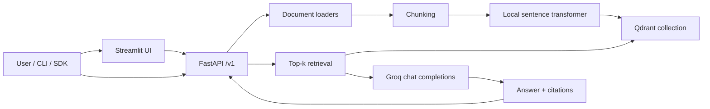

# Partitioned RAG Chatbot

[](https://github.com/Houssein2eba/partitioned-chatbot/actions/workflows/runner-test.yaml)

A full-stack Retrieval-Augmented Generation (RAG) chatbot that answers
questions from a private document collection. The application combines local
embeddings, a persistent vector database, an OpenAI-compatible LLM API, and
three user interfaces:

- A FastAPI REST API with interactive OpenAPI documentation
- A Server-Sent Events (SSE) streaming endpoint
- A Streamlit web interface
- A typed Python SDK and command-line client

The project demonstrates API development, vector search, RAG orchestration,
containerization, Kubernetes deployment, and CI/CD with GitHub Actions.

## Key capabilities

- **Grounded answers:** the model receives only retrieved document context and
  is instructed not to use unsupported knowledge.
- **Source citations:** responses identify cited files and the associated
  retrieved chunks.
- **Multiple interfaces:** REST, SSE, Streamlit, and Python CLI/SDK.
- **Document ingestion:** supports PDF, DOCX, TXT, MD, and Markdown files.
- **Document filtering:** retrieval can be restricted to selected filenames.
- **Idempotent indexing:** deterministic chunk IDs prevent duplicate points
  when a source is re-ingested.
- **API authentication:** optional API-key validation through `X-API-Key`.
- **Health and observability:** readiness information and structured JSON logs.
- **Container-first delivery:** Docker Compose, Kubernetes manifests, and
  automated build/test/deployment configuration.

## Architecture



### Runtime components

| Component | Responsibility | Technology |
|---|---|---|
| API | Authentication, upload, ingestion, retrieval, chat, streaming | FastAPI, Uvicorn, Pydantic |
| Knowledge base | Persistent chunk and metadata storage | Qdrant |
| Embeddings | Generate vector representations locally | `BAAI/bge-small-en-v1.5` |
| Answer generation | Generate document-grounded responses | Groq API |
| Web interface | Interactive browser chat | Streamlit |
| Client | HTTP transport, SSE parsing, typed convenience methods | Python, HTTPX |

## Repository layout

```text
app/
  api/               REST routes and API-key authentication
  rag/               Loading, chunking, embeddings, Qdrant, RAG pipeline
  config.py          Environment-based configuration
  logging_config.py  Structured application logging
  main.py            FastAPI application and lifecycle
  models.py          Request and response schemas
client/              Reusable HTTP SDK
scripts/             Ingestion and interactive CLI commands
ui/                  Streamlit chat interface
tests/               Unit and API tests
k8s/                 Kubernetes deployment manifests
.github/workflows/   CI/CD pipeline
data/                Local document corpus; excluded from Git by default
docker-compose.yml   Local development stack
Dockerfile           Production container image
Makefile             Common development commands
```

## Prerequisites

- Docker Desktop with Docker Compose v2
- Python 3.11 or later for local development
- A Groq API key
- PowerShell 7 or Windows PowerShell for the commands below
- Optional: Kubernetes and `kubectl` for cluster deployment

## Quick start with Docker Compose

### 1. Create local configuration

```powershell
Copy-Item .env.example .env
```

Set `GROQ_API_KEY` in `.env`. For local development, API authentication may be
left disabled. For shared or production-like environments, set
`APP_API_KEYS` and `RAG_API_KEY` to matching values.

Never commit `.env` or real credentials.

### 2. Add documents

Place supported files in `data/`:

- PDF
- DOCX
- TXT
- Markdown (`.md` and `.markdown`)

### 3. Start the stack

```powershell
docker compose up -d --build
docker compose ps
```

This starts Qdrant, the FastAPI API, and the Streamlit UI.

| Service | URL |
|---|---|
| Streamlit UI | <http://localhost:8501> |
| API | <http://localhost:8000> |
| OpenAPI / Swagger | <http://localhost:8000/docs> |
| Health | <http://localhost:8000/v1/health> |

### 4. Build the index

```powershell
curl.exe -X POST http://localhost:8000/v1/ingest
```

### 5. Ask a question

```powershell
curl.exe -X POST http://localhost:8000/v1/chat `
  -H "Content-Type: application/json" `
  -d '{\"question\":\"What is this document about?\"}'
```

Stop the stack with `docker compose down`. The named Qdrant volume preserves
indexed vectors. Use `docker compose down -v` only when deleting that data is
intentional.

## Local Python development

```powershell
py -3.11 -m venv .venv
.\.venv\Scripts\Activate.ps1
python -m pip install -r requirements.txt

Copy-Item .env.example .env
make qdrant
make ingest
make run
```

Run the UI in a separate terminal:

```powershell
.\.venv\Scripts\Activate.ps1
make ui
```

The Makefile also provides `make test`, `make ask`, `make up`, `make down`,
and `make logs`. On PowerShell, GNU Make must be available on `PATH`.

## Interfaces

### REST API

All application endpoints are versioned under `/v1`.

```text
GET  /v1/health
POST /v1/chat
POST /v1/chat/stream
POST /v1/ingest
POST /v1/upload
```

The complete request and response schemas are available in the interactive
OpenAPI documentation at `/docs`.

If authentication is enabled, add the configured key to requests:

```text
X-API-Key: <your-api-key>
```

Example chat request:

```json
{
  "question": "How many vacation days do new employees receive?",
  "history": [],
  "top_k": 5,
  "sources": ["handbook.pdf"]
}
```

Example response shape:

```json
{
  "answer": "New employees receive 15 vacation days per year.",
  "citations": [
    {
      "cited_text": "new hires accrue 15 days",
      "source": "handbook.pdf",
      "chunk_index": 3
    }
  ],
  "sources": [
    {
      "source": "handbook.pdf",
      "chunk_index": 3,
      "score": 0.82,
      "text": "Retrieved source text"
    }
  ],
  "model": "openai/gpt-oss-120b",
  "usage": {
    "input_tokens": 1203,
    "output_tokens": 48
  }
}
```

### Streaming

`POST /v1/chat/stream` returns SSE events:

- `sources`: retrieved chunks, sent before generation
- `text`: answer tokens as they arrive
- `done`: citations and usage metadata
- `error`: stream-level failures

```powershell
curl.exe -N -X POST http://localhost:8000/v1/chat/stream `
  -H "Content-Type: application/json" `
  -d '{\"question\":\"Summarize the security policy.\"}'
```

### Document upload

```powershell
curl.exe -X POST http://localhost:8000/v1/upload `
  -F "file=@./data/contract.pdf"
```

The uploaded file is stored in `DATA_DIR`, validated against the supported
extension list, and ingested immediately.

### CLI and SDK

```powershell
# One-shot question
python -m scripts.chat "What is our refund policy?"

# Interactive session
python -m scripts.chat

# Streaming options
python -m scripts.chat "Summarize the handbook" --no-stream --top-k 8 --sources
```

The SDK can be used directly from Python:

```python
from client.sdk import RagClient

with RagClient() as client:
    print(client.health())
    print(client.chat("What is this document about?"))
```

Configure the client with `RAG_API_URL` and `RAG_API_KEY`.

## How RAG works

1. Text is extracted from supported files.
2. Documents are split into overlapping chunks.
3. Chunks are converted into local embeddings.
4. Embeddings and source metadata are stored in Qdrant.
5. A question is embedded and searched against the collection.
6. The top matching chunks are sent to Groq with conversation history.
7. The model is instructed to answer only from that context.
8. If retrieval produces no sufficiently relevant chunks, the API returns a
   not-found response instead of invoking an unsupported answer.

Source filtering uses Qdrant payload metadata. Re-ingestion uses deterministic
point IDs derived from source name and chunk index, so existing points are
replaced rather than duplicated.

## Configuration

Copy `.env.example` to `.env` and configure the deployment:

| Variable | Default | Purpose |
|---|---|---|
| `GROQ_API_KEY` | empty | Groq API credential |
| `GROQ_MODEL` | `openai/gpt-oss-120b` | Chat completion model |
| `MAX_TOKENS` | `2048` | Maximum answer tokens |
| `EMBEDDING_MODEL` | `BAAI/bge-small-en-v1.5` | Local embedding model |
| `QDRANT_URL` | `http://localhost:6333` | Qdrant endpoint |
| `QDRANT_API_KEY` | empty | Optional Qdrant credential |
| `QDRANT_COLLECTION` | `documents` | Collection name |
| `DATA_DIR` | `./data` | Directory used for ingestion and uploads |
| `CHUNK_SIZE` | `512` | Target chunk size |
| `CHUNK_OVERLAP` | `64` | Overlap between neighboring chunks |
| `TOP_K` | `5` | Default number of retrieved chunks |
| `SCORE_THRESHOLD` | `0.5` | Minimum cosine retrieval score |
| `APP_API_KEYS` | empty | Comma-separated accepted API keys |
| `CORS_ORIGINS` | `*` | Comma-separated allowed browser origins |
| `LOG_LEVEL` | `INFO` | Application log level |
| `RAG_API_URL` | `http://localhost:8000` | CLI/UI API base URL |
| `RAG_API_KEY` | empty | API key used by the CLI/UI |

## Testing

The test suite runs without Qdrant or a Groq API key by mocking external
dependencies:

```powershell
python -m pytest -q
```

Common coverage areas include API routing, request validation, authentication,
chunking behavior, and SDK transport.

For Docker validation:

```powershell
docker build -t partitioned-chatbot:local .
docker compose config
docker compose up -d --build
docker compose ps
```

## Kubernetes

The `k8s/` directory contains manifests for a local Docker Desktop Kubernetes
cluster or a similar single-cluster environment:

- Namespace
- ConfigMap
- Qdrant StatefulSet and Service
- Persistent data claim
- API Deployment and Service
- Streamlit Deployment and Service

Build the local image, create the secret, apply the manifests, and open port
forwards as documented in [k8s/README.md](k8s/README.md) and
[k8s-instructions.md](k8s-instructions.md).

These manifests use `ClusterIP` services and do not provide public ingress,
DNS, TLS termination, or cloud-provider autoscaling.

## CI/CD

The GitHub Actions workflow in
[`.github/workflows/runner-test.yaml`](.github/workflows/runner-test.yaml)
uses a Windows self-hosted runner and separates continuous integration from
deployment:

```text
Pull request to main
  -> Python tests
  -> Docker image build validation

Push to main
  -> CI succeeds
  -> Build immutable image using GitHub SHA
  -> Push image to Docker Hub
  -> Deploy to Kubernetes
```

Before enabling deployment, configure the GitHub repository secrets:

- `DOCKERHUB_USERNAME`
- `DOCKERHUB_TOKEN`

For production environments, also configure a protected GitHub environment,
branch protection rules, deployment approvals, and cluster credentials.
Repository-level credential handling and infrastructure requirements are
documented in [ci-cd.md](ci-cd.md).

## Security

- Keep `GROQ_API_KEY` out of source control.
- Set `APP_API_KEYS` outside local development; an empty value intentionally
  leaves the API open.
- Restrict `CORS_ORIGINS` when browser access is public.
- Use HTTPS and a reverse proxy or ingress for internet-facing deployments.
- Store secrets in a platform secret manager or Kubernetes Secret.
- Replace the local Qdrant deployment with authenticated, backed-up storage
  for shared environments.
- Review documents for sensitive or regulated content before indexing.
- Treat uploaded files as untrusted input and apply malware scanning for public
  upload services.

The current API key mechanism is suitable for simple service-to-service
authentication. It is not a replacement for an OAuth/OIDC identity system,
fine-grained authorization, or per-user tenancy.

## Operations

Useful Docker commands:

```powershell
docker compose logs -f api
docker compose logs -f ui
docker compose logs -f qdrant
docker compose restart api
docker compose down
```

Verify service health:

```powershell
curl.exe http://localhost:8000/v1/health
```

Expected high-level states:

- `status: "ok"`: API can reach Qdrant.
- `status: "degraded"`: Qdrant is unreachable.
- `vectors`: number of indexed vectors in the configured collection.

The API container is non-root, JSON application logs are written to stdout, and
the Docker image includes a health check. Qdrant data is persisted by a named
Docker volume or Kubernetes PVC.

## Deployment and maturity

The repository provides working local, Docker Compose, Kubernetes, and CI/CD
paths. It is suitable as a portfolio project and for controlled internal
environments, but the following items should be addressed before a public,
multi-tenant production release:

- Managed or replicated Qdrant with backups and encryption
- TLS certificates and production ingress
- Centralized secrets and log/metrics/tracing providers
- Rate limiting and request-size controls
- Authentication with identity-provider integration
- Document access control and tenant isolation
- Automated model evaluation and retrieval quality monitoring
- Data retention and deletion workflows
- Disaster recovery and restore procedures

## Documentation index

- [DEPLOYMENT.md](DEPLOYMENT.md) - Docker and local deployment
- [k8s/README.md](k8s/README.md) - Docker Desktop Kubernetes deployment
- [k8s-instructions.md](k8s-instructions.md) - Detailed Kubernetes operations
- [ci-cd.md](ci-cd.md) - CI/CD and branch protection guidance
- [docker-compose.deploy.yml](docker-compose.deploy.yml) - Published-image deployment

## License

No license is currently declared in this repository. Add a license before
reusing or distributing the project outside your organization.
